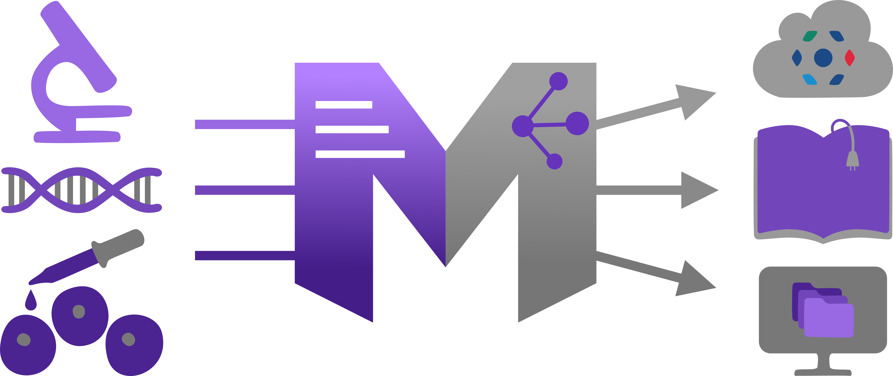
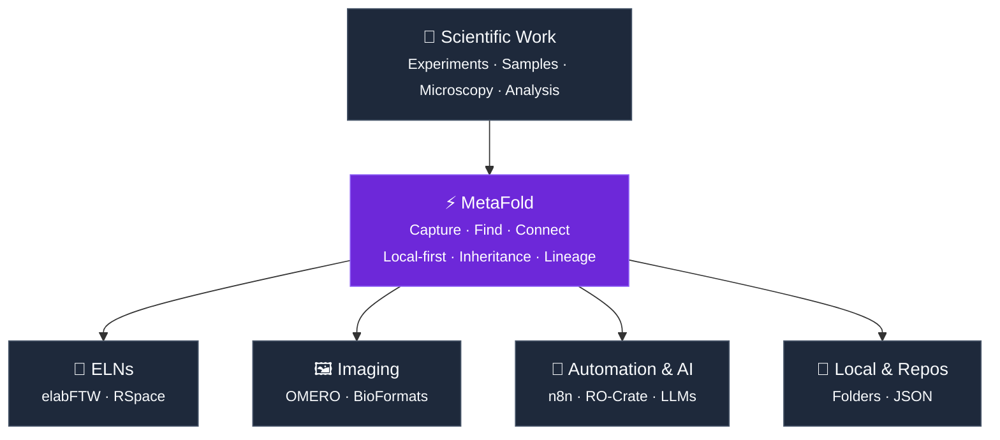

# Capture. Find. Connect.

**Capture what matters. MetaFold connects the rest.**  
*Less thinking about metadata. More focus on science.*

[Download Release](https://github.com/ThZobel/MetaFold/releases) · [Installation Guide](INSTALL.md) · [Documentation](https://metafold-docs.readthedocs.io/en/latest/) · [Example Templates](https://github.com/ThZobel/MetaFold/tree/main/templates)

---

## Contents

- [Why MetaFold?](#why-metafold)
- [How It Works](#how-it-works)
- [Features](#features)
- [Quick Start](#quick-start)
- [Documentation & Community](#documentation--community)

---

## Why MetaFold?

Scientists should focus on their research — not on metadata standards, folder schemas, or data management architecture.

**MetaFold** is a lightweight, **local-first** desktop application that lets you document your work as it happens. Standards like ISA or REMBI are handled behind the scenes, while your existing workflows and folder structures stay intact. MetaFold does not replace your ELN, LIMS, or image repository — it connects them.

| ✍️ Capture | 🔍 Find | 🔗 Connect |
| :--- | :--- | :--- |
| Document experiments on the fly with simple, reusable templates — no complex setup required. | Scan existing project folders and rediscover experiments via fast faceted metadata search. | Inherit metadata across folders, build data lineage, and sync directly with your lab systems. |

---

## How It Works

*Existing systems stay in charge of their specialized tasks. MetaFold connects them with structured metadata.*

---

## Features

- 📋 **Templates** — Lightweight, customizable JSON metadata forms with drag-and-drop fields and community templates on GitHub.
- ⚡ **Fast Project Creation** — Generate standardized folder structures and metadata files in seconds.
- 👥 **Group Management** — Multi-user & group-based access, ORCID/affiliation provenance, and encrypted local credentials.
- 🔍 **Find (Faceted Search)** — Recursively scan project folders and filter experiments dynamically by any metadata field.
- 🧬 **Visualize (Mermaid Lineage)** — Explore project dependencies, `derived from` relationships, and interactive knowledge graphs.
- 🔗 **Connect & Link (elabFTW, OMERO, RSpace)** — Create experiments or datasets with synced metadata and jump straight from search results to linked systems.
- 🤖 **Integrations & Automation (n8n, BioFormats, RO-Crate)** — Trigger n8n workflows via webhooks, extract OME-XML sidecars, and export AI-ready JSON & RO-Crates.

---

## Quick Start

1. Download the latest installer for **Windows**, **macOS**, or **Linux** from the [Releases page](https://github.com/ThZobel/MetaFold/releases).
2. Check the **[Installation & Setup Guide](INSTALL.md)** for platform instructions, building from source, and importing [example templates](https://github.com/ThZobel/MetaFold/tree/main/templates).

---

## Documentation & Community

- 📚 **[Full Documentation](https://metafold-docs.readthedocs.io/en/latest/)** — Setup guides, template tutorials, and integration references
- 🐛 **[Issues](https://github.com/ThZobel/MetaFold/issues)** & 💬 **[Discussions](https://github.com/ThZobel/MetaFold/discussions)** — Feedback, bug reports, and community exchange
- 🌐 **[NFDI4BioImage](https://nfdi4bioimage.de/)** — Developed as part of the NFDI4BioImage initiative

Acknowledgements & License

- **Inspiration:** Inspired by the [RDM-Desktop Tool](https://github.com/tomio13/RDM-Desktop) by T. Haraszti ([CC BY 4.0](https://creativecommons.org/licenses/by/4.0/)).
- **Development:** Built with the assistance of [claude.ai](https://claude.ai/) as part of **NFDI4BioImage**.
- **License:** See [LICENSE](LICENSE).

