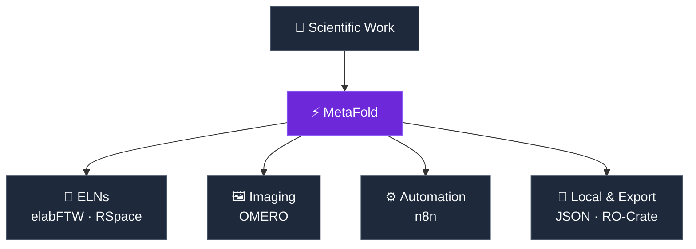
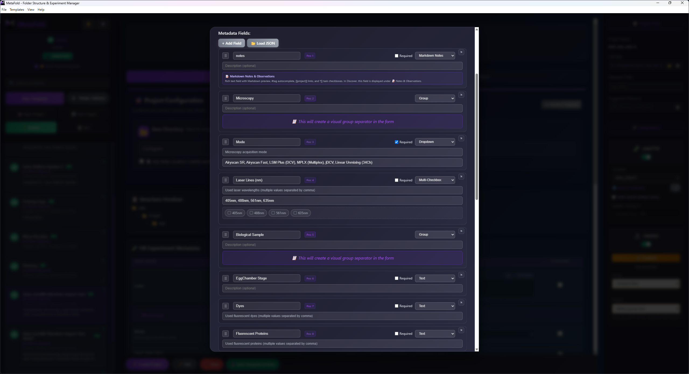
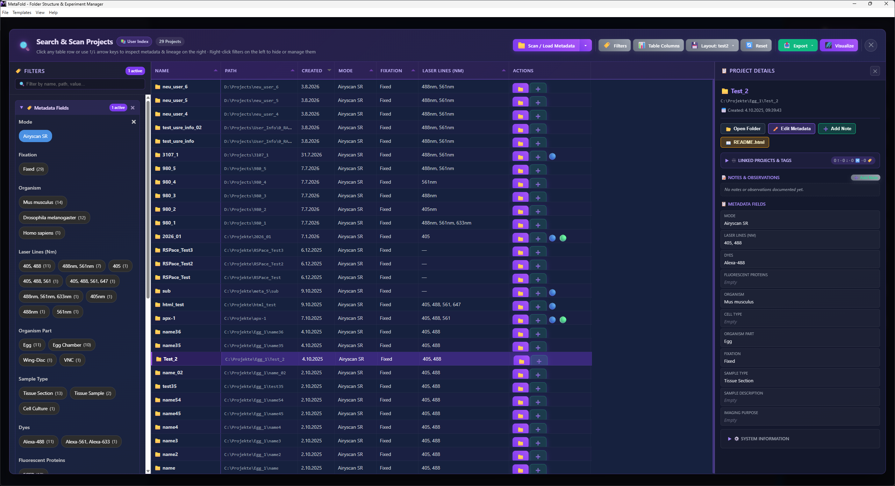
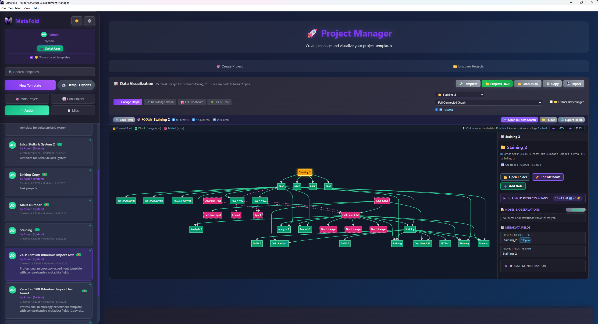

<h1>MetaFold Capture. Find. Connect.</h1>

**Capture what matters. MetaFold connects the rest.**

[Download Release](https://github.com/ThZobel/MetaFold/releases) · [Installation Guide](INSTALL.md) · [Documentation](https://metafold-docs.readthedocs.io/en/latest/) · [Example Templates](https://github.com/ThZobel/MetaFold/tree/main/templates)

> [!NOTE]
> **Built with AI — driven by scientific workflows.**  
> MetaFold is 100% AI “vibe-coded”: its code is generated through iterative prompting and AI-assisted development, guided by human-defined requirements and practical research needs.

---

## Contents

- [Why MetaFold?](#why-metafold)
- [How It Works](#how-it-works)
- [Screenshots](#screenshots)
- [Features](#features)
- [Quick Start](#quick-start)
- [Documentation & Community](#documentation--community)
- [Acknowledgements & License](#acknowledgements--license)

---

## Why MetaFold?

Scientists should focus on their research — not on metadata standards, folder schemas, or data management architecture.

**MetaFold** is a lightweight, **local-first** desktop application that lets you document your work as it happens. Standards like ISA or REMBI are handled behind the scenes, while your existing workflows and folder structures stay intact.

MetaFold does not replace your ELN, LIMS, or image repository — it connects them. Supported integrations automatically link the records created in external systems, connecting your local project, ELN experiment, and imaging dataset.

| ✍️ Capture | 🔍 Find | 🔗 Connect |
| :--- | :--- | :--- |
| Document experiments on the fly with simple, reusable templates — no complex setup required. | Scan existing project folders and rediscover experiments via fast faceted metadata search. | Inherit metadata across folders, build data lineage, and automatically link records across supported lab systems. |

---

## How It Works

*MetaFold creates local projects and connected records with matching metadata and automatically links records across supported systems. Later changes are not automatically synchronized.*
1. **Capture** your experiment using a reusable metadata template.
2. **Create** your local project and records in connected systems with the same metadata at creation time.
3. **Connect** those records through links and preserve their relationships.
4. **Find and reuse** your work through faceted search, lineage views, and structured exports.

*Existing systems stay in charge of their specialized tasks. Metadata is populated when records are created; subsequent changes are not continuously synchronized between systems.*

---

## Screenshots

<strong>Create a project from a template</strong>

Choose a reusable template, capture your experiment metadata, and generate the project structure.

<!--
Add the screenshot at assets/screenshots/project-creation.png,
then remove the comment markers around the image below.

-->

*Screenshot coming soon.*

<strong>Edit metadata templates</strong>

Build and adapt lightweight metadata forms for your workflows.

<!--
Add the screenshot at assets/screenshots/template-editor.png,
then remove the comment markers around the image below.

-->

*Screenshot coming soon.*

<strong>Find experiments with faceted search</strong>

Scan existing project folders, filter by metadata, and open linked records.

<!--
Add the screenshot at assets/screenshots/faceted-search.png,
then remove the comment markers around the image below.

-->

*Screenshot coming soon.*

<strong>Explore project lineage</strong>

View project dependencies and follow relationships between source and derived data.

<!--
Add the screenshot at assets/screenshots/project-lineage.png,
then remove the comment markers around the image below.

-->

*Screenshot coming soon.*

---

## Features

- 📋 **Templates** — Lightweight, customizable JSON metadata forms.
- ⚡ **Fast Project Creation** — Generate standardized folder structures and metadata files in seconds.
- 👥 **Group Management** — Multi-user & group-based access.
- 🔍 **Find (Faceted Search)** — Recursively scan project folders and filter experiments dynamically by any metadata field.
- 🧬 **Visualize (Mermaid Lineage)** — Explore project dependencies, `derived from` relationships, and interactive knowledge graphs.
- 🔗 **Connect & Link (elabFTW, OMERO, RSpace)** — Populate local metadata and connected records with the same metadata when creating them, automatically link records across supported systems, and open linked records directly from search results. Later changes are not automatically synchronized.
- ⚙️ **Workflow Automation (n8n)** — Trigger connected workflows via webhooks.
- 🖼️ **File Sidecars (BioFormats/bftools)** — Extract imaging metadata into OME-XML sidecar files.
- 📦 **Export** — Export structured metadata as JSON, export lineage information, and package metadata as RO-Crate for reuse and downstream processing.

---

## Quick Start

1. Download the latest installer for **Windows**, **macOS**, or **Linux** from the [Releases page](https://github.com/ThZobel/MetaFold/releases).
2. Check the **[Installation & Setup Guide](INSTALL.md)** for platform instructions, building from source, and importing [example templates](https://github.com/ThZobel/MetaFold/tree/main/templates).

---

## Documentation & Community

<!--
- 📚 **[Full Documentation](https://metafold-docs.readthedocs.io/en/latest/)** 
-->
— Setup guides, template tutorials, and integration references
- 🐛 **[Issues](https://github.com/ThZobel/MetaFold/issues)** & 💬 **[Discussions](https://github.com/ThZobel/MetaFold/discussions)** — Feedback, bug reports, and community exchange

---

## Acknowledgements & License

- **Inspiration:** Inspired by the [RDM-Desktop Tool](https://github.com/tomio13/RDM-Desktop) by T. Haraszti ([CC BY 4.0](https://creativecommons.org/licenses/by/4.0/)).
- **Development:** Built with the assistance of [claude.ai](https://claude.ai/) as part of **NFDI4BioImage**.
- **License:** See [LICENSE](LICENSE).
